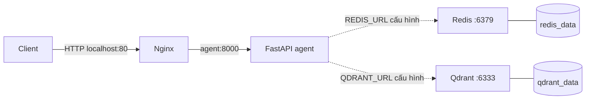

# Day 14 Lab — Mission Answers

## Part 1: Localhost vs Production

### Exercise 1.1: Phát hiện anti-patterns

Đối chiếu `01-localhost-vs-production/develop/app.py` với bản `production/`:

| Vấn đề trong develop | Vị trí code | Ảnh hưởng |
|---|---|---|
| API key hardcode | `OPENAI_API_KEY = ...` | Secret có thể bị lộ khi chia sẻ source hoặc commit lên GitHub. Key trong ví dụ là key giả. |
| URL database có tài khoản/mật khẩu hardcode | `DATABASE_URL = ...` | Làm lộ thông tin kết nối và gắn ứng dụng với database trên localhost. |
| Cấu hình cố định trong source | `DEBUG = True`, `MAX_TOKENS = 500` | Phải sửa code khi đổi môi trường hoặc giới hạn sử dụng. |
| Ghi secret ra log | `print(f"[DEBUG] Using key: {OPENAI_API_KEY}")` | Người đọc log cũng có thể thấy key; log có thể được lưu lâu hoặc chuyển sang hệ thống khác. |
| Dùng `print()` cho log | Các lệnh `print` trong `ask_agent()` | Khó lọc theo mức độ và truy vấn sự kiện bằng công cụ thu thập log. |
| Thiếu health check | Không khai báo route `/health` | Nền tảng thiếu endpoint chuyên dụng để kiểm tra ứng dụng còn sống. |
| Host và port cố định | `host="localhost"`, `port=8000` | Bind localhost hạn chế truy cập từ ngoài container; port không thích ứng với cấu hình nền tảng. |
| Bật reload cố định | `reload=True` | Chế độ phát triển không phù hợp để vận hành production. |
| Không có lifecycle cleanup do ứng dụng định nghĩa | Không có `lifespan` hoặc cleanup | Chưa chủ động đóng tài nguyên khi dừng. Uvicorn vẫn có cơ chế shutdown riêng, nên không thể kết luận mọi request đều bị cắt ngay. |

### Exercise 1.2: Chạy basic version

Đã chạy bản develop trong môi trường ảo Python bằng `python app.py`, mở Swagger tại `http://localhost:8000/docs` và gửi câu hỏi “Thời tiết hôm nay thế nào?” qua `POST /ask`.

Kết quả đã quan sát trong terminal:

- Server khởi động thành công trên cổng 8000.
- `/docs` và `/openapi.json` trả HTTP 200.
- `POST /ask?question=...` trả HTTP 200.
- Mock trả lời: “Tôi là AI agent được deploy lên cloud. Câu hỏi của bạn đã được nhận.”
- Terminal in câu hỏi, key giả hardcode và câu trả lời qua các dòng `[DEBUG]`.

Lệnh PowerShell để tái hiện request (develop nhận query parameter, không nhận JSON):

```powershell
Invoke-RestMethod -Method Post "http://localhost:8000/ask?question=Hello"
```

Ứng dụng chạy được trên máy nhưng chưa sẵn sàng cho production do các vấn đề ở Exercise 1.1. Câu trả lời đến từ mock LLM, không phải kết quả tra cứu thời tiết thật.

### Exercise 1.3: So sánh với advanced version

| Feature | Develop | Production | Tại sao quan trọng? |
|---|---|---|---|
| Config | Giá trị cố định trong source | `config.py` tập trung cấu hình, đọc bằng `os.getenv()` | Dùng cùng source cho development, staging và production. |
| Secrets | Key giả và URL database hardcode, in key ra log | Đọc key từ environment; handler không in key | Tách cấu hình nhạy cảm khỏi source và giảm nguy cơ lộ qua log. |
| Host/port | `localhost:8000` cố định | Đọc `HOST`, `PORT`, mặc định host `0.0.0.0` | Cho phép truy cập qua container và thích ứng port của cloud. |
| Reload | Luôn `True` | Theo `settings.debug`, mặc định `False` | Chỉ bật reload khi phát triển. |
| Health check | Không có `/health` | `/health` trả trạng thái, uptime, version, environment và timestamp | Cung cấp endpoint liveness cho nền tảng giám sát. |
| Readiness | Không có `/ready` | `/ready` kiểm tra cờ `is_ready`, chưa sẵn sàng trả 503 | Tách việc process còn sống khỏi việc sẵn sàng phục vụ. |
| Logging | `print()` và nội dung debug | Dùng `logging`, cấu hình format JSON và một số event qua `json.dumps()` | Hướng tới log có cấu trúc, dễ thu thập và phân tích. Chưa xác nhận log thực tế luôn là JSON hợp lệ. |
| Shutdown | Không có cleanup riêng của ứng dụng | Có `lifespan`, hạ cờ readiness và cleanup khi dừng; có handler SIGTERM | Cung cấp nơi quản lý vòng đời tài nguyên; việc chờ request còn phụ thuộc Uvicorn. Chưa thực hiện thí nghiệm SIGTERM khi có request đang chạy. |
| Kiểm tra cấu hình | Không validate môi trường production | Thiếu `AGENT_API_KEY` khi `ENVIRONMENT=production` thì báo lỗi ngay lúc khởi động | Phát hiện cấu hình thiếu trước khi nhận traffic. |
| Input `/ask` | `question` trong query string | Đọc `question` từ JSON body, thiếu/rỗng trả 422 | Client cần gửi request theo đúng hợp đồng của từng bản. |

#### Kết quả production đã kiểm chứng

1. Chạy ở cổng 8000 với environment `development`: `/health` trả `status: ok`.
2. Đổi `ENVIRONMENT=production`, `PORT=8001`: ứng dụng từ chối khởi động do thiếu `AGENT_API_KEY`, với lỗi `AGENT_API_KEY must be set in production!`.
3. Đặt thêm API key thử nghiệm bằng biến môi trường rồi khởi động lại: `/health` tại `http://localhost:8001/health` trả `status: ok`, `version: 1.0.0`, `environment: production`.
4. Không đặt OpenAI API key: ứng dụng cảnh báo dùng mock LLM và vẫn khởi động được.

Các bước trên chứng minh đổi port và môi trường mà không sửa source. `AGENT_API_KEY` được yêu cầu trong cấu hình chưa có nghĩa endpoint Part 1 đã thực hiện xác thực; bảo vệ API được thực hành ở Part 4.

#### Trả lời câu hỏi thảo luận

1. **Push API key thật lên GitHub public:** người khác có thể lấy key để sử dụng dịch vụ trái phép và phát sinh chi phí. Cần thu hồi/đổi key; xóa dòng code ở commit mới không xóa key khỏi lịch sử.
2. **Vì sao stateless quan trọng khi scale:** request của cùng người dùng có thể vào các instance khác nhau. State dùng chung phải nằm ở kho ngoài như Redis để các instance truy cập nhất quán, đồng thời không mất chỉ vì process restart.
3. **Dev/prod parity:** giữ môi trường phát triển và production tương đồng về runtime, dependencies và backing services để giảm lỗi chỉ xuất hiện khi deploy. Các giá trị khác nhau theo môi trường được truyền qua cấu hình.

#### Checkpoint 1

- [x] Chỉ ra ít nhất 5 anti-pattern và vị trí code.
- [x] Chạy develop và nhận HTTP 200 từ `/ask`.
- [x] Chạy production và kiểm tra `/health`.
- [x] Đổi port/environment bằng biến môi trường.
- [x] Giải thích health check và graceful shutdown qua code; không coi đây là bằng chứng đã test SIGTERM.
- [x] Hoàn thành bảng so sánh và câu hỏi thảo luận.

## Part 2: Docker

### Exercise 2.1: Dockerfile cơ bản

1. **Base image:** `python:3.11`, cung cấp Python runtime và hệ điều hành nền cho image develop.
2. **Working directory:** `WORKDIR /app`; các lệnh tiếp theo và command chạy ứng dụng dùng thư mục `/app` trong container.
3. **Copy requirements trước source:** dependencies thường ít thay đổi hơn source. Copy `requirements.txt` rồi cài dependencies trước giúp Docker tái sử dụng layer cài đặt khi chỉ thay đổi code.
4. **CMD và ENTRYPOINT:** `ENTRYPOINT` định nghĩa chương trình chính; `CMD` cung cấp command mặc định nếu không có ENTRYPOINT, hoặc đối số mặc định cho ENTRYPOINT. Đối số sau tên image trong `docker run` thay thế CMD; dùng `--entrypoint` để thay ENTRYPOINT. Dockerfile develop dùng `CMD ["python", "app.py"]`.

### Exercise 2.2: Build và run

Đã build image `agent-develop`, chạy container `agent-develop-demo` với mapping `8000:8000`, gọi `Invoke-RestMethod http://localhost:8000/health` và nhận:

```text
status uptime_seconds container
ok                9.9      True
```

Đây là kết quả health check đã chạy thật. Kích thước image và kết quả `/ask` trong container chưa được ghi nhận.

### Thực hành bổ sung: layer order và cache

Đã build hai Dockerfile bằng builder `day14-builder` (driver `docker-container`), sửa source rồi build lại. Kết quả từ log:

| Bước | deps-first | source-first |
|---|---|---|
| `COPY go.mod .` | CACHED | CACHED |
| `COPY main.go .` | Chạy lại | Chạy lại |
| `RUN go mod download` | CACHED | Chạy lại, 0.1 giây |
| `RUN CGO_ENABLED=0 go build -o myapp .` | Chạy lại, 6.2 giây | Chạy lại, 6.0 giây |

Ở deps-first, bước tải dependencies đứng trước bước copy source nên không mất cache khi chỉ sửa `main.go`. Ở source-first, bước đó đứng sau source nên bị chạy lại. Module ví dụ không có dependency ngoài (`go: no module dependencies to download`), vì vậy kết quả chứng minh cache invalidation, không chứng minh mức tiết kiệm thời gian tải dependencies thực tế. Thời gian export/load image không phải thời gian compile.

Đã bổ sung `RUN go mod download` sau `COPY main.go` vào `Dockerfile.source-first` để thí nghiệm khớp README; bản khung ban đầu thiếu bước này. Dockerfile develop cũng được sửa đường dẫn COPY và thêm mock cục bộ khi file mock ở gốc còn bị thiếu.

### Exercise 2.3: Multi-stage build

- Builder cài build tools và Python dependencies vào `/root/.local`.
- Runtime bắt đầu từ `python:3.11-slim`, copy dependencies đã cài và source; chạy bằng `appuser`.
- Final image bỏ các build tools cài ở builder. Mức giảm dung lượng phải đo bằng image thực tế; multi-stage không tự loại mọi công cụ có sẵn trong base image.

Số đo thực tế từ `docker image ls` và `docker image inspect` do người học chạy:

| Image | Kích thước hiển thị | Kích thước inspect (byte) |
|---|---|---|
| `agent-develop:latest` | 1.67 GB | 1,667,780,208 |
| `agent-production:latest` | 240 MB | 239,815,360 |

Phần trăm giảm = `(1,667,780,208 - 239,815,360) / 1,667,780,208 × 100` = **85.62%**. Theo đơn vị thập phân, hai giá trị lần lượt khoảng 1667.78 MB và 239.82 MB. Image production nhỏ hơn 500 MB. Chênh lệch này đến từ cả base image full so với slim và việc tách build tools khỏi runtime, không chỉ riêng multi-stage.

### Exercise 2.4: Docker Compose stack

Đã chạy project Compose `k5-day14-docker`, sử dụng image production vừa build (tag lại thành `k5-day14-docker-agent:latest`) và file `.env.local` rỗng cho mock LLM.



Các service dùng mạng bridge `internal` và phân giải tên service bằng Docker DNS. Nginx publish cổng 80 và 443 trên host, nhưng cấu hình hiện tại chỉ lắng nghe HTTP 80, chưa cấu hình HTTPS. Agent không publish cổng trực tiếp ra host. Redis và Qdrant có named volume để lưu dữ liệu. `depends_on` yêu cầu Redis/Qdrant healthy trước khi khởi động agent.

Các đường từ agent đến Redis/Qdrant trong sơ đồ thể hiện biến kết nối đã cấu hình. Code mock hiện tại trong `main.py` chưa gọi Redis hoặc Qdrant; chưa thể kết luận đã có cache hay retrieval thực tế.

Kết quả người học chạy:

- `docker compose -p k5-day14-docker ps`: có agent, Nginx, Redis và Qdrant; Redis/Qdrant healthy. Agent mới khởi động, hiển thị `health: starting` ở thời điểm chụp output; chưa có kết quả xác nhận agent chuyển sang healthy.
- `Invoke-RestMethod http://localhost/health`: trả `status: ok`, `uptime_seconds: 13.5`, `version: 2.0.0`, `timestamp: 2026-11-25T16:08:55.633732`.
- Gửi JSON `{"question":"Explain microservices"}` bằng `POST http://localhost/ask`: nhận object có trường `answer`. Tiếng Việt trong output PowerShell bị lỗi hiển thị/giải mã; chưa kiểm chứng nguyên nhân encoding.

Như vậy request từ host đã đi qua Nginx tới agent và nhận phản hồi.

Kiểm tra bổ sung sau khi stack chạy khoảng một phút:

- `docker compose -p k5-day14-docker ps`: agent, Redis và Qdrant đều healthy; Nginx đang Up.
- `docker compose -p k5-day14-docker logs --tail 20 agent`: Uvicorn khởi động parent PID 1 và hai worker, có log `Agent ready`; access log xác nhận `GET /health` và `POST /ask` trả HTTP 200.
- `docker compose -p k5-day14-docker exec agent sh -c 'pwd; id; ls'`: output được gửi xác nhận `/app`, `uid=999(appuser) gid=999(appuser)`. Container chạy bằng non-root user. Chưa ghi nhận phần output `ls`.

Lưu ý từ log thực tế: dòng event request có JSON lồng trong chuỗi `msg` nhưng dấu nháy chưa được escape, nên không phải JSON hợp lệ. Đây là hạn chế của format logging trong bản mẫu Part 2; khi triển khai structured logging ở Part 6 cần dùng serialization đúng thay vì ghép chuỗi JSON.

#### Checkpoint 2

- [x] Giải thích Dockerfile, CMD và ENTRYPOINT.
- [x] Build/chạy container basic, kiểm tra health.
- [x] Thực hành layer cache sau thay đổi source.
- [x] Đo kích thước image develop/production và tính phần trăm giảm.
- [x] Giải thích hai stage builder/runtime.
- [x] Vẽ sơ đồ stack Compose và kiểm tra `/health`, `/ask` qua Nginx.
- [x] Xác nhận agent healthy và thực hành xem log / exec vào container.

## Part 3: Cloud Deployment

### Exercise 3.1/3.2: Deploy agent Part 6

Đã triển khai agent trong `06-lab-complete/` lên **Render**, với Redis-compatible Key Value và public URL **https://day14-agent-8reb.onrender.com**. Ban đầu Railway báo vượt giới hạn tạo tài nguyên gói Free và yêu cầu nâng cấp; người học chuyển sang Render, không triển khai thêm trên Railway.

Người học đã gửi ảnh public `/health` trả `status: ok`, `environment: production`; `/ready` trả `ready: true`. Swagger Server response xác nhận `POST /ask` thiếu key → **401**, key hợp lệ → **200** với câu hỏi Hello và câu trả lời mock. Chi tiết, response và lệnh tái kiểm tra ở [DEPLOYMENT.md](DEPLOYMENT.md). Ảnh trong hội thoại cần được lưu thêm vào `screenshots/` trước khi nộp.

#### So sánh cấu hình Railway và Render trong repo

| Nội dung | `railway.toml` | `render.yaml` |
|---|---|---|
| Định dạng | TOML, cấu hình build/deploy cho service | YAML Blueprint, khai báo danh sách services và environment |
| Docker build | `builder = "DOCKERFILE"`, `dockerfilePath = "Dockerfile"` | `type: web`, `runtime: docker`, `dockerfilePath: ./Dockerfile` |
| Thư mục nguồn | Thiết lập service root `06-lab-complete/` trên Railway | File có `rootDir: 06-lab-complete` tính từ gốc repo |
| Health check | `healthcheckPath = "/health"`, timeout 100 | `healthCheckPath: /health` |
| Secret | Đặt bằng biến môi trường của service, không có giá trị key trong TOML | `AGENT_API_KEY` có `generateValue: true`; `REDIS_URL` có `sync: false`, cần nhập riêng |
| Redis | Cần tạo thêm service và cấu hình URL | Cấu hình hiện tại chưa khai báo Key Value; người học tạo thủ công và đặt Internal URL |
| Restart | File đặt `restartPolicyType = "ON_FAILURE"` | File không khai báo restart policy tương ứng |

Khác biệt do schema và cách quản lý service của mỗi nền tảng. Cả hai dùng cùng Dockerfile ứng dụng và biến môi trường; không đưa Compose local lên cloud như một service duy nhất. Việc deploy bằng giao diện Render không đồng nghĩa Blueprint đã được tự động áp dụng; bảng trên so sánh các file trong repo.

### Exercise 3.3: Pipeline Cloud Run (đọc cấu hình, không deploy)

1. `cloudbuild.yaml` định nghĩa bước cài dependencies và chạy `pytest tests/`; trigger theo nhánh cần được cấu hình riêng, không được tạo chỉ bằng comment trong YAML.
2. Bước Docker build tạo image có tag commit SHA và `latest`, rồi push lên registry `gcr.io/$PROJECT_ID/ai-agent` theo thứ tự `waitFor`.
3. Bước deploy chạy `gcloud run deploy` với image theo SHA, region `asia-southeast1`, giới hạn 1–10 instance, CPU/RAM/timeout và secret từ Secret Manager.
4. `service.yaml` là cấu hình declarative triển khai qua `gcloud run services replace`: image, tài nguyên, concurrency, env/secrets và probes; pipeline mẫu hiện dùng lệnh deploy, không tự đọc file này.
5. Đây là phân tích code mẫu, chưa chạy GCP. Nếu dùng thật cần làm bước test fail-fast (`bash -e` hoặc `set -e`) vì lệnh `echo` cuối script hiện có thể che exit code lỗi của pytest.

## Part 4: API Security

### Exercise 4.1: API Key authentication

`04-api-gateway/develop/app.py` dùng `APIKeyHeader(name="X-API-Key", auto_error=False)` và dependency `verify_api_key` trong `/ask`. Key được đọc từ `AGENT_API_KEY`. Bản mẫu trả 401 khi thiếu key, **403 khi key sai**, 200 khi key đúng. Điều này khác hợp đồng Part 6, nơi thiếu hoặc sai đều phải 401. Rotate key bằng cách thay biến môi trường, restart các instance và cập nhật client; khi key lộ cần thu hồi key cũ.

Đã chạy kiểm tra FastAPI TestClient trong process riêng bằng `python scripts/verify_part4.py`. Đây là kiểm tra API trong process, không phải bằng chứng đã deploy hay bản chụp `curl -i`. Output thật: [evidence/part4-check.txt](evidence/part4-check.txt).

```text
missing key: HTTP 401
wrong key (original Part 4 example): HTTP 403
valid key: HTTP 200
```

### Exercise 4.2: JWT authentication

Client gửi tài khoản demo tới `POST /auth/token`; server kiểm tra rồi ký JWT HS256 chứa `sub`, `role`, `iat`, `exp`. Client gửi `Authorization: Bearer <token>`; server xác minh chữ ký và hạn dùng trước khi nhận danh tính/role. Token hết hạn sau 60 phút. JWT được ký không có nghĩa payload được mã hóa; không nhét secret vào payload.

Đã kiểm tra tài khoản demo student đăng nhập thành công (200), thiếu JWT bị 401; student gọi `/admin/stats` bị 403, teacher có role admin gọi thành công 200. Token không ghi vào bằng chứng. Trong service thật cần secret ký từ môi trường, mật khẩu được hash và kho tài khoản thay cho demo users.

### Exercise 4.3: Rate limiting

Code mẫu dùng deque lưu timestamp và loại các request cũ hơn 60 giây: về hành vi là sliding-window log trong RAM. User thường được 10 request/phút; admin được 100 request/phút, **không bypass vô hạn**. Bypass nếu cần phải dựa trên role đã xác minh ở server, không tin role client tự khai báo; lab không thay đổi chính sách mẫu này.

Kết quả 20 request student liên tiếp trong process sạch:

```text
200, 200, 200, 200, 200, 200, 200, 200, 200, 200,
429, 429, 429, 429, 429, 429, 429, 429, 429, 429
```

State RAM của ví dụ không dùng chung giữa worker và mất khi restart. Bản Part 6 thay bằng Redis + Lua, kiểm tra/ghi timestamp nguyên tử và có `Retry-After`.

### Exercise 4.4: Cost guard

Demo `cost_guard.py` gốc dùng budget ngày trong RAM. Đã kiểm tra đặt daily budget 0 thì request có JWT hợp lệ bị 402. Không gọi đây là budget tháng trong Redis.

Đã bổ sung lời giải riêng ở `04-api-gateway/production/monthly_budget.py`: `check_budget(user_id, estimated_cost, client)` dùng Redis, budget **10 USD/user/tháng UTC**. Hash user ID trong key, thêm tháng vào key để bắt đầu kỳ mới; TTL dọn dữ liệu cũ. Dùng integer nano-USD và Lua để kiểm tra/cộng tiền nguyên tử, tránh hai request cùng nhìn thấy số dư cũ. Đây là giữ chỗ theo estimated cost; khi dùng LLM thật cần đối soát với cost thực tế, hoàn phần giữ chỗ thừa hoặc xử lý request thất bại. Helper này chưa nối vào endpoint demo daily guard, được kiểm tra độc lập.

Đã chạy [scripts/verify_monthly_budget.py](scripts/verify_monthly_budget.py) với Redis tạm trong Linux: 20 lần đồng thời, mỗi lần 1 USD, chấp nhận đúng 10 và từ chối 10; request thêm 0.01 USD bị từ chối, user khác có ngân sách riêng. Bằng chứng: [evidence/part4-monthly-budget.json](evidence/part4-monthly-budget.json).

Rate limit kiểm soát tần suất, cost guard kiểm soát tiền. Request ít nhưng prompt/model đắt vẫn có thể hết budget, vì vậy cần cả hai.

## Part 5: Scaling & Reliability

### Exercise 5.1: Health và readiness

`/health` trả trạng thái process; `/ready` cho biết service sẵn sàng phục vụ hay chưa. Khi phụ thuộc như Redis không hoạt động, nên giữ liveness 200 để tránh vòng restart vô ích, readiness 503 để ngừng nhận traffic. Bản develop kiểm tra cờ readiness, không kiểm tra Redis thật; bản production có ping Redis trong `/ready`.

Kiểm tra HTTP thật trong Linux container: `/health` 200, `/ready` 200. Bằng chứng ở [evidence/part5-shutdown.json](evidence/part5-shutdown.json).

### Exercise 5.2: Graceful shutdown

Luồng mong đợi: nhận SIGTERM → Uvicorn ngừng nhận kết nối mới, chờ request đang xử lý → lifespan cleanup đóng tài nguyên → process thoát. SIGKILL không cho cleanup.

Đã sửa bản develop: bỏ đăng ký signal handler chỉ ghi log vì khi import bằng Uvicorn CLI, handler này có thể ghi đè handler của Uvicorn và khiến process không tắt. Giữ cơ chế signal của Uvicorn và lifespan sẵn có.

Đã gửi request thật, sau 0.05 giây gửi SIGTERM: request trả 200 và log có `Application shutdown complete`. Uvicorn 0.30 trong phép thử một process này phát lại SIGTERM sau cleanup nên exit code POSIX là **-15**, không ghi nhận thành 0. Part 6 multi-worker đã được kiểm tra riêng theo hợp đồng exit code 0. Bằng chứng: [evidence/part5-shutdown-server.txt](evidence/part5-shutdown-server.txt), [evidence/part5-shutdown.json](evidence/part5-shutdown.json).

Mock thực tế chỉ chờ khoảng 0.1 giây; không sử dụng mô tả “3 giây” trong README làm số đo.

### Exercise 5.3: Stateless design

Mỗi process có bộ nhớ riêng, nên lưu history trong dict có thể làm request tiếp theo mất ngữ cảnh khi chuyển instance. Bản production đưa session/history vào Redis; các instance dùng cùng `REDIS_URL` và session ID. Stateless ở đây nghĩa là không phụ thuộc RAM của một instance để giữ state hội thoại, không có nghĩa hệ thống hoàn toàn không có state.

### Exercise 5.4: Load balancing

Đã build image và chạy `docker compose -p k5-day14-scaling up -d --no-build --scale agent=3`. Nginx publish cổng 8080 và chuyển request `/chat` tới các agent trên mạng nội bộ; Redis lưu session dùng chung. Đã lưu trạng thái/log trước khi dừng stack: [evidence/part5-status.txt](evidence/part5-status.txt), [evidence/part5-agent-logs.txt](evidence/part5-agent-logs.txt).

### Exercise 5.5: Test stateless

Đã chạy script gốc `test_stateless.py` trên stack 3 agent. Năm request cùng session được phục vụ bởi 3 instance (`instance-38be10`, `instance-de934f`, `instance-638dcd`); history có đủ **10 message** (5 user, 5 assistant). Script báo session được giữ qua các instance. Script không tự kill instance và lần này chưa có thí nghiệm failover khi kill; không coi kết quả này là bằng chứng failover.

Bằng chứng nguyên gốc: [evidence/part5-stateless.txt](evidence/part5-stateless.txt). Stack kiểm thử đã được dừng sau khi thu thập kết quả.

## Part 6: Production-ready AI Agent

### Triển khai

Code nằm đúng trong `06-lab-complete/`. Không sửa `check_production_ready.py` hoặc golden dataset.

- `config.py`: đọc environment và `.env`; môi trường hiện tại có ưu tiên cao hơn file.
- `auth.py`: đọc `X-API-Key`, so sánh bằng `secrets.compare_digest`, thiếu/sai/rỗng trả 401; không log secret.
- `redis_client.py`: kết nối lazy với timeout; Redis mất không ngăn process khởi động.
- `rate_limiter.py`: sliding window 60 giây, timestamp từ Redis, member UUID, key hash API key, Lua nguyên tử; state dùng chung và giữ qua restart agent.
- `cost_guard.py`: ghi tổng cost theo ngày và tháng UTC trong Redis, check trước gọi LLM, trả 402 khi đã hết budget. Đây là budget tổng service, không phải từng user. Token của mock được ước tính theo độ dài, response đánh dấu `estimated: true`. Request đang xử lý đồng thời có thể vượt budget vì chưa có giữ chỗ trước gọi LLM.
- `main.py`: `/health`, `/ready`, `/ask`, validation, JSON logger dùng serialization đúng, Redis lỗi trả 503 và lỗi ngoài dự kiến trả thông báo chung; Uvicorn quản lý signal và lifespan đóng Redis sau khi drain request.
- Docker: multi-stage slim, user non-root, HEALTHCHECK, lắng nghe PORT, exec Uvicorn PID 1; Compose có agent + Redis AOF/named volume.
- Có Railway/Render config. Sau lần hoàn thiện code, người học đã deploy lên Render cùng Redis cloud và kiểm tra public URL ở Part 3; xem `DEPLOYMENT.md`.

### Bằng chứng kiểm tra

1. Windows, script gốc chạy đầy đủ: **11/12**, 42/42 checks chạy được pass; SIGTERM local không kiểm tra được trên Windows. Image **238 MiB theo script chấm**, `docker stop` exit 0 trong **0.7 giây**. [evidence/part6-windows-check.txt](evidence/part6-windows-check.txt).
2. Linux container không Docker socket, script gốc `--skip-docker`: **10/12**, 39/39 checks chạy được pass, gồm SIGTERM khi có request → 200, process exit 0. Còn cảnh báo đúng các bước Docker chưa chạy trong môi trường đó. [evidence/part6-linux-runtime.txt](evidence/part6-linux-runtime.txt).
3. Đã chạy script gốc **đầy đủ trong Linux container**, có Docker CLI/socket được người học cho phép riêng: **PASS 12/12, 43/43 checks passed**. Đây là một lần chấm đầy đủ, không cộng gộp kết quả hai môi trường. Output nguyên gốc: [evidence/part6-full-check.txt](evidence/part6-full-check.txt).

Trích phần Checklist Deliverable của lần chấm đầy đủ:

```text
📋 Checklist Deliverable
   ✅ Dockerfile (multi-stage, < 500 MB)
   ✅ docker-compose.yml (agent + redis)
   ✅ .dockerignore
   ✅ Health check endpoint (GET /health)
   ✅ Readiness endpoint (GET /ready)
   ✅ API Key authentication
   ✅ Rate limiting
   ✅ Cost guard
   ✅ Config từ environment variables
   ✅ Structured logging
   ✅ Graceful shutdown
   ✅ Public URL ready (Railway / Render config)
Result: 12/12 tiêu chí đạt · 43/43 checks passed
🎉 PASS 12/12 — PRODUCTION READY! Deploy nào!
```

`Public URL ready` trong script chỉ xác nhận cấu hình deploy sẵn sàng. Public URL Render đã được người học kiểm chứng riêng ở Part 3 (health/readiness, thiếu key 401, key đúng 200); có `DEPLOYMENT.md`. Còn cần lưu ảnh triển khai vào repo để đủ hồ sơ nộp.

## AI log

Part 3 bổ sung: ChatGPT/Codex hướng dẫn chuyển từ Railway sang Render, tạo Key Value, cấu hình web service và kiểm tra Swagger. Người học tự thực hiện deploy và gửi ảnh health/readiness/401/200; Codex đối chiếu ảnh, viết `DEPLOYMENT.md`, so sánh file cấu hình và mô tả Cloud Run từ source. Chưa thực hiện deploy GCP hay Railway; chưa xác nhận ảnh đã được lưu vào repo.

| Phạm vi | Đã hỏi / hỗ trợ nhận được | Tự thực hiện và kiểm chứng |
|---|---|---|
| Part 1 | Nhờ ChatGPT/Codex giải thích yêu cầu, hướng dẫn chạy develop/production, phân tích lỗi địa chỉ `0.0.0.0` và lỗi thiếu `AGENT_API_KEY`; hỗ trợ đọc code và soạn câu trả lời Part 1. | Tự chạy server, gọi `/ask` trong Swagger, kiểm tra `/health` bằng trình duyệt và PowerShell; đổi env/port và gửi kết quả. Nội dung báo cáo được đối chiếu với code và các kết quả này. Cần tự đọc lại và giải thích các câu trả lời trước khi nộp. |
| Part 2 và Git (đang làm) | Nhờ hướng dẫn build Docker, xử lý lỗi snapshot bằng builder riêng, sửa đường dẫn COPY mock LLM và kiểm tra trạng thái Git xóa/thêm trùng. | Đã tự chạy container, kiểm tra `/health`, chạy các lệnh build và gửi log. Codex sửa Dockerfile, thêm mock, khôi phục index và file gốc bị thiếu |
| Part 4–6 | Nhờ Codex hoàn thiện các phần. Codex đọc code mẫu, viết helper budget tháng Redis, sửa handler signal Part 5, triển khai các TODO Part 6, viết script kiểm tra và soạn báo cáo từ kết quả thực tế. | Trong đợt này **Codex chạy kiểm thử**, không ghi thành người học tự chạy: TestClient Part 4; Redis concurrency; stack 3 instance và script gốc Part 5; HTTP/SIGTERM Linux; script chấm Part 6 nguyên gốc đầy đủ PASS 12/12. Người học cho phép gắn Docker socket cho lần chấm đầy đủ. Người học cần tự đọc, chạy lại và giải thích code/kết quả; chưa ghi nhận bước tự kiểm tra đó trong đợt này. |
